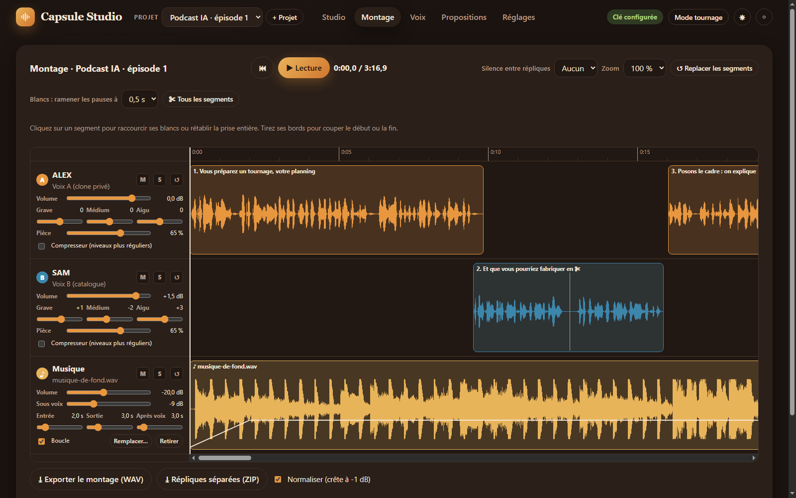
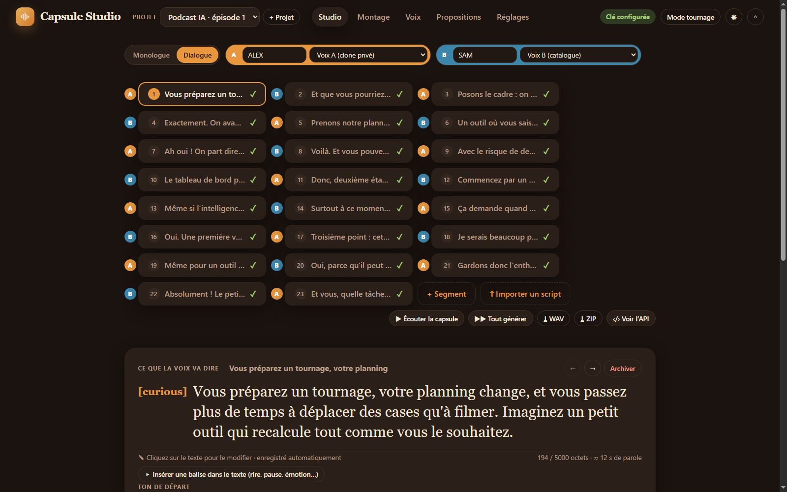

# Capsule Studio

**Studio de voix off et de podcasts à deux voix, qui tourne sur votre ordinateur, avec l'API [Fish Audio](https://fish.audio).**

Vous écrivez le texte, vous choisissez le ton avec des balises (`[calm]`, `[excited]`, `[laughing]`…), Fish Audio le dit avec votre voix clonée ou une voix du catalogue. Vous écoutez, vous comparez les prises, vous gardez la meilleure, puis vous montez le tout : deux pistes, égaliseur, compresseur, musique de fond, export WAV.

> Application indépendante, non affiliée à Fish Audio. Vous utilisez **votre propre clé API** : les générations sont faites et facturées sur votre compte Fish Audio.



## Fonctions

- **Studio** : segments de texte, balises d'émotion en français, plusieurs prises par segment, comparaison, choix de la meilleure.
- **Dialogue A/B** : deux voix par projet, import d'un script `ALEX: … / SAM: …` en un clic.
- **Voix** : clonage privé de votre voix (avec consentement), import de vos voix Fish Audio, catalogue filtrable avec écoute.
- **Montage** : une piste par voix, volume, égaliseur 3 bandes, compresseur, réverbération de pièce, décalages et chevauchements, coupes, blancs raccourcis automatiquement, musique de fond avec baisse sous les voix.
- **Exports** : un seul WAV, ZIP des prises nommées par réplique, répliques traitées séparées (pour HeyGen ou un logiciel vidéo).
- **Agent IA** (facultatif) : un agent externe (Claude, ChatGPT, Hermes, un script…) peut proposer des textes, ou travailler seul en mode autonome, avec un jeton séparé et des droits limités.
- **Garde-fous** : modèle gratuit par défaut, générations payantes désactivées tant que vous n'avez pas fixé de budget, limite quotidienne.



## Installation (Windows)

1. Téléchargez `capsule-studio-vX.Y.Z-windows.zip` dans les [Releases](../../releases/latest).
2. Décompressez-le où vous voulez (par exemple `Documents\Capsule Studio`).
3. Double-cliquez sur **`lancer-capsule-studio.bat`**. Le navigateur s'ouvre sur l'application.

Node.js est inclus dans le ZIP (dossier `runtime`) : rien d'autre à installer. Fermer la fenêtre noire arrête l'application.

> Windows peut afficher « Windows a protégé votre ordinateur » au premier lancement d'un fichier téléchargé : « Informations complémentaires » → « Exécuter quand même ».

### macOS et Linux

Installez [Node.js 22.12 ou plus récent](https://nodejs.org), téléchargez le code source (`Source code (zip)` dans les Releases), puis :

```bash
cd capsule-studio
./lancer-capsule-studio.sh      # ou : node server.js
```

et ouvrez <http://127.0.0.1:8746>.

## Premier lancement

1. **Créez votre mot de passe** (10 caractères minimum). Il protège l'application et l'accès de l'agent.
2. **Collez votre clé API Fish Audio** ([fish.audio → API Keys](https://fish.audio/app/api-keys/)). Elle est vérifiée auprès de Fish Audio puis enregistrée sur votre ordinateur uniquement.
3. **Ajoutez une voix** (onglet Voix) : clonez la vôtre ou choisissez-en une au catalogue.
4. Écrivez votre première phrase et générez.

Tout le reste se règle dans **Réglages** : générations payantes et budgets, limite quotidienne, accès de l'agent, accès depuis le réseau local.

## Modèles et coûts

| Modèle | Coût | Par défaut |
|---|---|---|
| S2.1 Pro Free | gratuit pendant l'[offre Fish Audio](https://fish.audio/blog/s2-1-pro-free-api) | ✅ |
| S2.1 Pro | payant (tarif Fish Audio) | désactivé |
| Drama 3 | payant, expérimental | désactivé |

Quand l'offre gratuite prend fin, activez les générations payantes dans Réglages en fixant un budget total et un plafond par requête. Le coût estimé est affiché avant chaque génération. Si Fish Audio prolonge l'offre, corrigez simplement la date dans Réglages.

## Vos données

Projets, prises audio, voix et réglages restent sur votre ordinateur :

- Windows : `%APPDATA%\CapsuleStudio`
- macOS : `~/Library/Application Support/CapsuleStudio`
- Linux : `~/.local/share/capsule-studio`

Le dossier exact est affiché dans Réglages → Garde-fous. **Sauvegarde** : copiez ce dossier, application fermée. Une mise à jour de l'application ne touche jamais à vos données.

## Mettre à jour

Téléchargez la nouvelle version, décompressez-la (à la place de l'ancienne ou à côté), relancez. Vos données sont conservées. Les nouveautés sont listées dans le [CHANGELOG](CHANGELOG.md).

## Agent IA

Dans Réglages → Accès agent, générez un jeton et donnez à votre agent le guide [`docs/AGENT-USAGE.md`](docs/AGENT-USAGE.md) ainsi que le guide d'écriture [`docs/guide-balises.md`](docs/guide-balises.md). L'agent n'a jamais accès à votre clé Fish Audio, à vos voix, à vos budgets ni aux réglages.

## Sécurité et vie privée

- L'application écoute uniquement sur `127.0.0.1` (votre ordinateur). L'accès réseau local est facultatif, en HTTPS, limité aux adresses privées.
- La clé Fish Audio n'est jamais envoyée au navigateur, à l'agent, dans les journaux ou les exports.
- Aucune télémétrie. Les seuls appels sortants vont à l'API Fish Audio.
- Pendant l'offre gratuite, Fish Audio peut utiliser les requêtes pour améliorer ses modèles : n'envoyez pas de textes confidentiels.

## Clonage de voix : règle d'usage

Ne clonez que **votre propre voix** ou celle d'une personne qui vous a donné son **accord explicite** (écrit, de préférence). Respectez les conditions d'utilisation de Fish Audio. Vous êtes responsable des contenus générés.

## Pour les développeurs

Aucune dépendance npm. Node.js 22.12 ou plus récent.

| Commande | Rôle |
|---|---|
| `npm start` | Démarre le serveur |
| `npm run dev` | Idem, avec rechargement automatique |
| `npm test` | Tests automatisés (faux Fish Audio, aucun appel réel, aucune dépense) |
| `npm run release` | Construit le ZIP portable Windows (Node inclus) dans `dist/` |

Un fichier `.env` facultatif permet de régler le port, le dossier de données, etc. (voir [`.env.example`](.env.example)). Documentation technique : [`docs/PROVIDER-COMPATIBILITY.md`](docs/PROVIDER-COMPATIBILITY.md), [`docs/api-contract.yaml`](docs/api-contract.yaml).

## Licence

[MIT](LICENSE). Créé par Johan Solutions Digitales.

---

### English (short)

**Capsule Studio** is a local voice-over and two-voice podcast studio built on the Fish Audio API. Download the Windows portable ZIP from the Releases page, unzip, double-click `lancer-capsule-studio.bat`, create a password and paste your own Fish Audio API key. The interface is in French. All data stays on your computer. MIT licensed.
